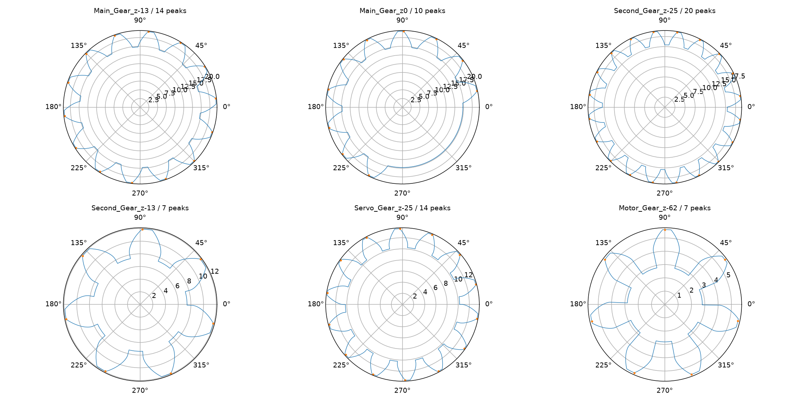
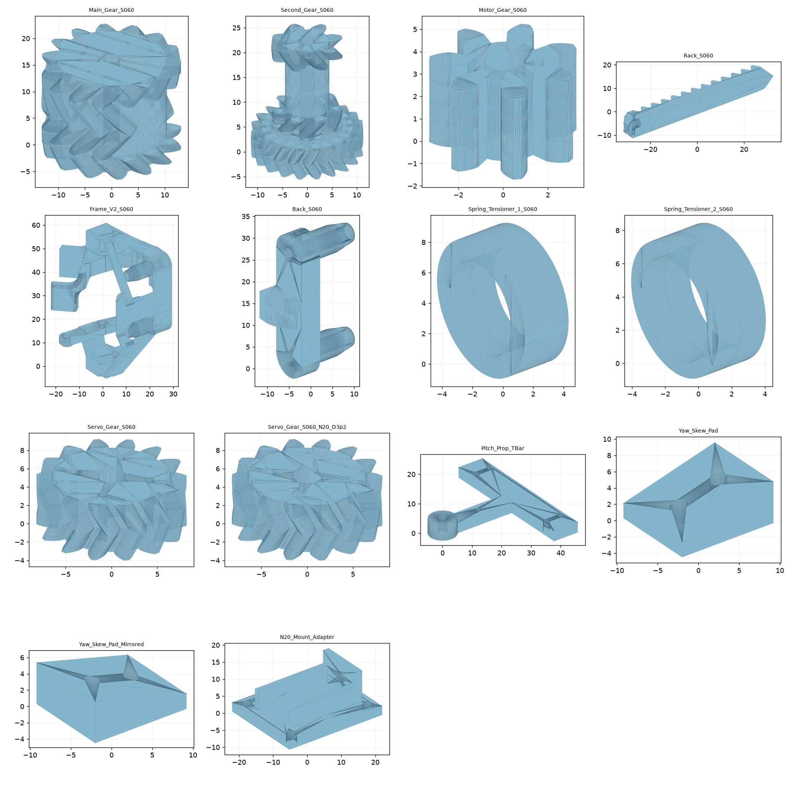
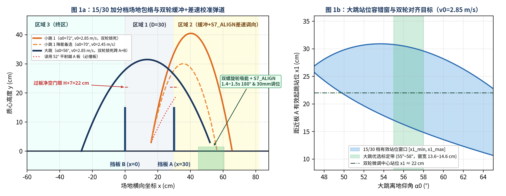
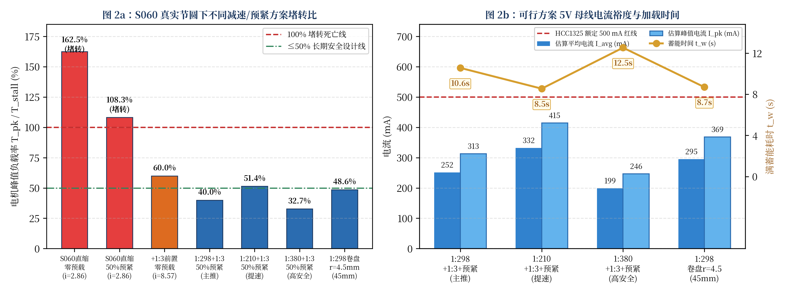
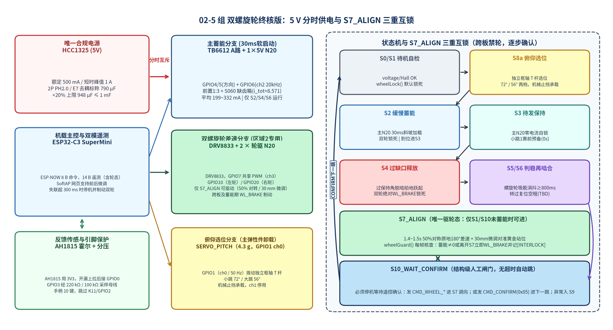

# 不靠腿的跳跃机器人（Legless Jump Robot）—— 仿生机理、动力学模型与全套工程实现

> **课程项目**：2026 秋季《自然与设计》—— 不用腿的跳跃机器人 V3.0（02-5 组：杨钊、田浩男、郑雯文）
> **当前定稿基线**：`0.60x` 缩比双 8 辐螺旋柔性轮 + 缺齿齿轮直线蓄能弹射箱 + 汉阳大学式 T 型前撑杆调仰角 + ESP32-C3 `v1.2.0` 三电机分时互锁系统
> **硬红线指标**：整机设计预算 **`126~132 g`（中心 `129.0 g < 150 g`）**｜首轮自购 BOM **`¥284 / 300 元`**｜供电 **课程统一 `HCC1325` `5 V / 500 mA`（分时峰值 `< 320 mA`）**｜母线总去耦 **`790 µF`（+20% 最坏 `948 µF ≤ 1 mF`）**

---

## 📌 一眼区分：哪个是 `M1`（第 3 周验证模型）？哪个是 `M2`（最终竞赛样机）？

> **记住一句话**：**M1 绝对不带电机、电池、电路板、也不装双螺旋轮**；**M2 才是带双轮 + ESP32-C3 + 3 颗 N20 电机 + 舵机的最终参赛机器人**。

| 阶段模型 | 仓库对应文件夹 | 核心特征（别打错件！） | 适用场景与直达入口 |
|---|---|---|---|
| **🟠 M1（第 3 周 · 验证模型实物，3D 打印手拧版）** | **[`M1_路线A_纯机械手拧缺齿弹射版/`](M1_路线A_纯机械手拧缺齿弹射版/)** | **纯机械 9 件套**（含防勒手梅花手拧旋钮 + 棘爪，**无电机 / 无舵机 / 无轮子 / 无电路板**），用手拧转到缺齿区即自动弹射 | 🟡 **你要打印 M1 就进这个文件夹！** 👉 A1 + 0.2mm PETG 现成切片工程：[`03_A1_0.2mm_PETG分件3MF工程/`](M1_路线A_纯机械手拧缺齿弹射版/03_A1_0.2mm_PETG分件3MF工程/) 👉 打印与组装指南：[`README_M1路线A打印与公差补偿及组装指南.md`](M1_路线A_纯机械手拧缺齿弹射版/README_M1路线A打印与公差补偿及组装指南.md) |
| **🟠 M1（第 3 周 · 验证模型实物，手工木条原版）** | **[`第二三周_D1与M1/`](第二三周_D1与M1/)** | 对齐第 1 周 `R1.docx` 的**轻木双杆 + 摆钩 + 橡皮筋**纯手工方案（无需 3D 打印） | 🌟 **3D 交互演示网页（双击直接看怎么装怎么跳）**：[`M1_手工叩甲虫双杆模型_3D与原理交互演示.html`](第二三周_D1与M1/M1_手工叩甲虫双杆模型_3D与原理交互演示.html) 查阅 `01_M1零件尺寸材料与制作调试指南.md` 与 `D1` 手绘作图指南 |
| **🔵 M2（第 4~12 周 · 最终电控三跳机器人）** | **[`3D打印专用文件夹/`](3D打印专用文件夹/)** + **[`BV15T4y1q75R_魔改适配方案/`](BV15T4y1q75R_魔改适配方案/)** | **全套 14 种共 18 件**（含双 8 辐螺旋轮 `Wheel_1/2`、`Motor_Gear`、`N20_Mount_Adapter` + 3 颗 N20 + 1 舵机 + ESP32-C3 电控与固件 `v1.2.0`） | 🔵 **最终竞赛样机打印 & 采购 & 烧录点这里**：[`3D打印专用文件夹/`](3D打印专用文件夹/) 与 [`README_3D打印喷头分盘与网购BOM实操总表.md`](BV15T4y1q75R_魔改适配方案/README_3D打印喷头分盘与网购BOM实操总表.md) |

---

## 一、 仿生跳跃原理与课程规则映射

本项目的核心工程约束在于：**不使用传统多关节仿生腿、不使用反冲/推进器/发射架、不拆解机体**，仅依托课程配发的单块 `HCC1325`（`5 V / 500 mA` 额定、`1 A` 短时峰值）锂电池，在 `150 g` 总重与 `300 元` 预算红线内，完成考核场地 **区域 1 →（越隔板 A）→ 区域 2 →（原地 180° 反向）→ 区域 3（一次连跨隔板 B + A）** 的全流程可控跳跃。

### 1.1 双生物机理融合（从 R1 / D1 / M1 到 M2 的演进）

| 仿生维度 | 生物原型与自然机理 | 第 1~3 周原理验证（R1 / D1 / M1） | 第 4~12 周最终样机（D2 / M2 工程映射） |
|---|---|---|---|
| **① 能量蓄积与瞬时释放** | **叩甲虫（Click Beetle, Elateridae）**：胸节肌肉慢速收缩拉伸弹性铰链，靠前胸突刺卡入中胸凹槽锁止；越过临界点后毫秒级脱扣，驱动躯体猛烈拍地获得远超肌肉直接收缩功率的起跳加速度。 | 两根轻木主干绕中心铰链弯折，以橡皮筋储能、摆钩锁止、拉线释放实现单次纯机械无腿跳跃（及 M1 路线 A 纯机械手拧缺齿弹射验证版）。 | **小功率 5V N20 慢速上弦 + 双层夹心缺齿主齿轮（`Main_Gear_S060`）自动脱齿释放**：输入电机只需低功率拉紧机内齿条与弹性体，主齿轮转至中央层 **4 齿缺口区** 时瞬间失去啮合约束，弹性势能在毫秒级释放并驱动机体完整离地跃起。 |
| **② 起跳仰角与落距调控** | **圆跳虫（Springtail, Symphypleona）**：通过调整弹器与地面的初始支撑倾角，在近似恒定的单次储能下灵活分配“拔高量（垂直分量）”与“跨距（水平分量）”。 | M1 仅通过支点块与三档拉筋伸长量演示起跳规律。 | **绕轮轴摆动的 T 型前撑杆（`Pitch_Prop_TBar`）**：由 1 颗 `4.3 g` 微舵机空载拨档（到位后由机械硬止挡承力、舵机断电），在 **高抛小跳档（`α₀ ≈ 70°~72°`）** 与 **远跨大跳档（`α₀ ≈ 56°~57°`）** 之间切换，同一储能箱即可兼容“越单板”与“连跨双板”。 |
| **③ 高抛落地抗倾覆与姿态恢复** | **柔顺外骨骼吸能 + 圆形包络防死锁**：高抛落体若刚性触地极易弹跳侧翻躺死导致失去二次起跳姿态。 | M1 不考核连续续跳与转向。 | **一对 `Φ72 × 12 mm` 8 辐阿基米德螺旋柔性轮（`Wheel_1/2_S060`）**：承担着陆弹性吸能防倾覆、区域 2 平地差速 180° 反向与校距、以及 T 型前撑杆的天然旋转枢轴三大物理角色。 |

### 1.2 课程规则关键边界说明
- **辅助轮与跨板纯跳跃的界定**：任务书《Legless Jump Robot2026B.pdf》第 13 页第 6 条明确允许使用辅助轮子/轮轴；第 14 页第 9 条限定 **“在跨越隔板过程中的移动方式只能采用跳跃方式”**。
- 本方案采用 **“跨板全程电磁制动锁死（`WL_BRAKE`）+ 仅在区域 2 纯平地面 `S7_ALIGN` 差速调向”** 的三重软件互锁机制；同时提醒在正式评审前向任课教师/助教书面确认“区域 2 平地原地掉头使用差速轮”的判定口径（固件保留 `HAVE_YAW_SERVO` 退回代码分支）。

---

## 二、 机械构型演化与真实 CAD/STL 几何解析

本方案在开源项目 **Basement Creations《Jumping Robot V2》（Printables `156544` / Thingiverse `4976714`）** 与 **汉阳大学可调角跳跃机器人（`BV15T4y1q75R`）** 基础上，针对课程硬红线进行了系统性重构：

| 对比维度 | 原版 Printables 156544 | 本组魔改定稿版（S060 · 1+2+1 构型） | 改造原因 |
|---|---|---|---|
| **整机包络与质量** | `228.8 × 122.0 × 168.0 mm`，整机约 `340 g` | 整体 **`0.60x`** 缩比，设计预算 **`126~132 g`（中心 `129.0 g`）** | 原版超重 `190 g`，必须缩比减重以满足 `< 150 g` 课程红线 |
| **电源与动力架构** | `2S 7.4V 800mAh` 航模锂电 + `55 g` MG946R 大舵机 + 双轮 N20 | 课程统一 **`HCC1325 5V/500mA`** + **1 加载 N20(`1:298`) + 2 轮驱 N20(`1:75/100`) + 1 俯仰微舵机(`4.3 g`)** | 严格满足 `5V/500mA` 合规供电，用 `10 g` N20 替代 `55 g` 大舵机立省 `45 g` |
| **起跳角度控制** | 固定仰角（无法兼顾短距拔高与远距跨双板） | 新增自研参数化 **`Pitch_Prop_TBar`**（绕轮轴摆动三档调姿） | 一台机构实现“小跳跨单板 A + 大跳连跨 B+A 双板” |
| **轮驱轴与五金配合** | 原版 `Φ5` 轴、`Φ6` 铝管、`Φ3` 轮驱轴孔 | 经实测截面校验：**取消 `MR63ZZ` 与 `3→2` 联轴套**；轮驱直购 **真实 `Φ2.0 mm` 输出圆轴 N20** 与 `Motor_Gear_S060` 做 `Φ1.95~2.00 mm` 固定配合；三纵管改 **`Φ3.5 mm` 直铝管** + Frame `OD 4.20/ID 3.55` 滑动衬套；横销改 **`Φ1.6 mm` 304 钢丝** | `0.60x` 缩比后 `Motor_Gear_S060` 齿根圆仅 `Φ3.375 mm` 严禁扩至 `Φ3`，STEP 端面净空仅 `1.73/1.83 mm` 塞不下联轴套 |

### 2.1 真实 STEP/STL 网格切片实测几何参数（Python + OpenCascade 直接解析）

对下载的 `Jumping_Robot_V2_.step`（44 个 BRep 实体）与全部 13 件原版 STL、18 件魔改 STL 执行闭合流形、体积分与轴向极坐标切片分析，得到真实传动链参数：
- **齿轮链齿数与总外减速比**：
  - `Servo_Gear_S060_N20_D3p2`（`14T`，自研重开 `Φ3.2 mm` D 型轴孔） $\rightarrow$ `Second_Gear_S060`（`20T / 7T` 双联复合齿轮） $\rightarrow$ `Main_Gear_S060`（两侧完整人字齿名义 **`14T`**，中央加载层实测 **`10 齿 / 缺 4 齿位`**，缺口名义中心角 `102.86°`）
  - 总外齿轮减速比：$i_{\text{ext}} = \frac{20}{14} \times \frac{14}{7} = \frac{20}{7} \approx \mathbf{2.857:1}$
- **齿条与主轮节圆实测**：
  - 原版 `Rack` 12 齿周期齿距 $p_0 = 8.8858\text{ mm}$（模数 $m_0 \approx 2.828\text{ mm}$）；
  - `0.60x` 缩比后齿距 **$p = 5.3315\text{ mm}$**（模数 **$m \approx 1.697\text{ mm}$**），主齿轮真实节圆半径 **$r_p = 11.879\text{ mm}$**，10 齿名义加载行程 **$s_{\text{nom}} = 53.31\text{ mm}$**。
- **双螺旋轮真实截面复核**：
  - `Wheel_1_S060` / `Wheel_2_S060` 实测为 **`8 辐`** 阿基米德螺旋轮（`Φ72 × 12 mm`），单辐壁厚仅 **`0.475~0.483 mm`**，必须采用 **`0.2 mm` 喷头 + Arachne 变线宽** 保证每辐两道连续走线（Bambu Studio `A1 mini / Generic PLA` 试切双轮耗材约 `7.27 g`，PETG 待复切实称）。

*图 1：基于原版 STL 网格直接轴向切片提取的各齿轮极坐标齿顶分布（实证 `Main_Gear` 外环 14T / 中央层 10T 缺 4 齿位、`Second_Gear` 20T/7T、`Servo_Gear` 14T、`Motor_Gear` 7T）*

*图 2：0.60x 缩比齿轮箱核心件与自研改型零件（`Servo_Gear_S060_N20_D3p2`、`N20_Mount_Adapter`、`Pitch_Prop_TBar`、`Back_S060` 修复件等）三维预览*

---

## 三、 三次跳跃弹道动力学与 5V N20 堵转边界模型

### 3.1 考核场地“两小一大”弹道包络与黄金站位窗

针对整机质量 $m = 129.0\text{ g}$（预算区间 `126~132 g`），综合空气阻力与起跳角动量分配（总动能修正系数 `1.15`、弹性到起跳总机械效率 $\eta \approx 0.42\sim 0.45$）：
- 跨加分档（`15/30 cm` 双板连跨）需起跳初速 $v_0 \approx 2.85\text{ m/s}$ $\Rightarrow$ 目标动能 $E_{k,\text{tot}} \approx \mathbf{0.602\text{ J}}$ $\Rightarrow$ 弹性储能需求 **$E_{\text{spr}} \approx 1.35\sim 1.43\text{ J}$**。
- **三段动作协同策略**：
  1. **第 1 段（区域 1 → 区域 2，小跳高抛越单板 A）**：`Pitch_Prop_TBar` 下压撑高至 **`α₀ ≈ 70.2°~72°`**（`φ_open = 45°`），优先换取垂直越板高度，平地射程 `48.7 cm`（降能档 `33~39 cm`），稳定落入区域 2；
  2. **第 2 段（区域 2 原地调向 `SEG_PIVOT` → `S7_ALIGN`）**：弹簧**不蓄能、不起跳**；T 杆抬收至 `110°` 档避让桌面，左右 8 辐轮以 `50%` 对称 PWM 差速对转约 `1.4~1.5 s` 完成 **`180°` 原地反向**，并微调站位精确送入距 A/B 板 **`13.6~14.6 cm`（加分档最优 `15~25 cm`）黄金起跳窗**；
  3. **第 3 段（区域 2 → 区域 3，大跳远跨连越 B+A 双板）**：双轮立即 `WL_BRAKE` 电磁锁死，T 杆切换至 **`α₀ ≈ 56.6°`**（`φ_open = 70°`），满程释能射程达 **`76.1 cm`**，单跳连跨双隔板直达区域 3。全流程核心动作耗时压缩至 **`20~35 s`**（相对 `240 s` 赛限余量 `> 200 s`）。

*图 3：考核场地“小跳 1 越单板 A → 区域 2 双轮差速 180° 反向入窗 → 大跳 3 连跨双板至区域 3”质心弹道包络与站位宽容窗口仿真*

### 3.2 `5V N20` 堵转边界量化与弹性体选型模型

以实测 S060 主轮节圆半径 $r_p = 11.879\text{ mm}$、有效行程 $s = 53.31\text{ mm}$、`1:298` N20 实标堵转扭矩 $T_{\text{stall}} = 180\text{ N}\cdot\text{mm}$ 为基线，定量校核单跳储能 `1.35 J` 所需的电机负载率：

| 传动配置（实测 $r_p = 11.879\text{ mm}$） | 弹性加载曲线（`1.35 J` / `53.3 mm`） | 峰值扭矩 / 堵转比 | 估算电流 | 工程判定 |
|---|---|---|---|---|
| `N20 1:298` + 原直缩外级（$i=2.857, \eta=0.72$） | 零预载 $0 \to 50.6\text{ N}$ | 远超 `100%`（最大不堵转拉力仅 `31.2 N`） | 超限 | ❌ **绝对不可行（必堵转）** |
| `N20 1:298` + 原直缩外级（$i=2.857, \eta=0.72$） | 50% 预张紧 $16.9 \to 33.8\text{ N}$ | **`108.3%` 堵转** | 超限 | ❌ **即使 50% 预张紧仍必堵** |
| **`N20 1:298` + 前置 `1:3` 减速**（$i_{\text{tot}}=8.571, \eta=0.65$） | **50% 预张紧 $16.9 \to 33.8\text{ N}$** | **`72.0 / 180 N·mm`（仅 `40.0%` 堵转；最大不堵拉力 `84.4 N`）** | **模型峰值 `~313 mA`** | ✅ **推荐主方案（安全落在 `5V/500mA` 区）** |

- **弹性体落地方案（两阶段验证）**：
  - **M11 首轮散料（¥12）**：废止因中管锁死无法拉伸的 `25~35 mm` 短拉簧；采用 **`1×3 mm` 印尼航模皮筋 + `Φ2×4 mm` 高弹乳胶管**，挂于 `Frame` 轮轴孔外侧固定耳 $\leftrightarrow$ 外管前端止退耳片（实测无穿插弦长 **`31.44 → 80.90 mm`**，轻松匹配 `53.31 mm` 齿程）。
  - **M12 二批压簧（条件购买，¥9~11）**：若 D3 保留导杆压簧路线，选用 `65Mn / SWP-B` 长压簧 **`d=0.80 × OD 8.4~8.5 (ID 6.8~6.9) × L_free 125~130 mm`**（端面磨平、并紧 `32.0~35.6 mm`）+ 4 片止偏平垫片（最小有效座距 `42.89~43.49 mm`，留 `7.29~11.49 mm` 防并圈余量，全包络峰值扭矩 `≤ 48.5%`，双簧验收峰力 `≤ 41 N`）。

*图 4：基于实测 `S060` 节圆半径（$r_p = 11.879\text{ mm}$）的主蓄能 N20 扭矩堵转比与 5V 母线电流/蓄能时间标定曲线*

---

## 四、 5V 合规电控架构、三重互锁与分时供电状态机

### 4.1 硬件真源与电源合规设计（V2.2 终核定案）
- **主控与遥控**：双 `ESP32-C3 SuperMini`（固件 `v1.2.0`，两端均已通过 `arduino-cli --warnings all --clean` **0 error / 0 warning** 编译），支持 **ESP-NOW 10 键实体手柄（K1~K10，跳过 strapping 脚 `GPIO2/K11`、无 OLED）** 与 **手机 Wi-Fi 网页 `192.168.4.1`** 双通道遥控。
- **驱动与传感分工**：
  - 第 1 片 **`TB6612FNG`**：驱动主蓄能 `N20 (1:298)`；
  - 第 2 片 **`DRV8833`**：驱动左右差速轮驱 `N20 (1:75/100)`；
  - 零位检测：**`AH1815` 全极霍尔传感器（`3.3V` 开漏接 `GPIO0`，禁用 `3144E 5V` 与机械微动开关）**；
  - 母线监测：**`R1=220k / R2=100k` 1% 分压接 `GPIO3`（必装）**；
  - **`E7'` 去耦电容组（严守 `≤ 1 mF` 课程红线）**：定案为 **`470 µF/16V ×1 + 220 µF/16V ×1 + 100 µF/16V ×1 = 标称 790 µF`**（105℃ 低 ESR，+20% 上限 `948 µF ≤ 1 mF`），三只就近分置于 `TB6612 VM` / `DRV8833 VM` / 舵机排针；`5 V` 储能仅 `9.9 mJ`（单跳 `1.35 J` 的 `0.73%`），作用严格界定为 **“抑制电机换向尖峰与负载瞬态”**。上电严格遵守 **“先插电池、再拨开关”**。

### 4.2 三重跨板锁死互锁 + 分时互斥供电
1. **分时互斥供电（不超 `500 mA` 的核心保障）**：主蓄能电机、左右轮驱电机、俯仰舵机三大执行器组在状态机内**严格互斥**，任何时刻仅允许一组运行，母线稳态峰值出现在蓄能阶段（`~310 mA`，始终 `< 320 mA`，低于 `500 mA` 额定的 `64%`）。
2. **跨板纯跳跃三重代码互锁**：
   - 闸门 ① `wheelAllowed()`：仅在 `S7_ALIGN` 且主蓄能占空比 `= 0` 时放行轮驱；
   - 闸门 ② `enter()`：状态切入非 `S7_ALIGN`（如 `S2` 蓄能、`S3` 待发、`S4` 释放、`S5` 落稳）瞬间无条件执行 `wheelLock()`（`WL_BRAKE` 电磁短路制动锁死）；
   - 闸门 ③ `wheelGuard()`：每次 `loop()` 实时巡检，若检测到非 `S7` 态存在轮驱输出立即强制锁死并打印 `[INTERLOCK]` 日志留痕。

*图 5：1+2+1 三电机分时电控架构与含 `S7_ALIGN` 三重跨板锁死互锁的控制状态机*

---

## 五、 整机质量预算与首轮 ¥284 经费分配总览

| 维度 | 分配构成（设计预算，待首轮实物称重与台架实测替换） | 课程红线与裕量 |
|---|---|---|
| **整机质量预算** | 电控不含电池 **`45.8 g`**（含 `E7'` 电容 `2.7 g`）+ `HCC1325` 电池 **`11.0 g`** = 电控含电池 **`56.8 g`**；结构与机械件 **`69.2~75.2 g`**（中心 `72.2 g`）⇒ 整机 **`126~132 g`（中心 `129.0 g`）** | 硬红线 **`≤ 150 g`**（余量 `18~24 g`） |
| **自购经费预算** | 机械五金与弹性体 **`¥76`**（M1~M11）+ 电控器件 **`¥171`**（E1~E8）+ 焊装辅料 **`¥37`**（E10）= 首轮 **`¥284`**；若二批增补 M12 长压簧+垫片（`+¥9~11`）及按需 M2 螺丝（`+¥2~4`）仍 **`≤ ¥295~299`**（课程免费配发仅 **2 组 `HCC1325` 电池模组**） | 硬红线 **`≤ 300 元`**（首轮留余 `¥16`，留存正规发票） |

---

## 六、 仓库完整文档与工程文件导航

| 模块 | 文件 / 目录入口 | 内容说明 |
|---|---|---|
| **3D 打印分盘与 ¥284 照抄采购总表** | [`BV15T4y1q75R_魔改适配方案/README_3D打印喷头分盘与网购BOM实操总表.md`](BV15T4y1q75R_魔改适配方案/README_3D打印喷头分盘与网购BOM实操总表.md) | 全部 14 种（18 件）`0.2 mm` 喷头四盘切片设置、精确淘宝下单规格 M1~M12 / E1~E10 与装机避坑条款 |
| **第 4 周正式 Word 报告（D2）** | [`BV15T4y1q75R_魔改适配方案/D2_系统设计初稿（基于开源魔改版）.docx`](BV15T4y1q75R_魔改适配方案/D2_系统设计初稿（基于开源魔改版）.docx) | 含仿生原理、STL/STEP 实测解析、弹道与堵转标定、电控状态机、质量与 ¥284 预算表及 3 张 300 DPI 内嵌附图 |
| **交互式 3D 模型与动画预览** | [`BV15T4y1q75R_魔改适配方案/魔改跳跃机器人_3D交互预览与STL清单.html`](BV15T4y1q75R_魔改适配方案/魔改跳跃机器人_3D交互预览与STL清单.html) | 单文件离线 WebGL，支持双击浏览器查看 3D 装配、齿轮箱透视、爆炸滑块与“小跳→二区差速掉头→大跳”动画 |
| **机械结构与 STL 详案（V1.3）** | [`BV15T4y1q75R_魔改适配方案/01_机械结构合规魔改与三次跳跃实现方案.md`](BV15T4y1q75R_魔改适配方案/01_机械结构合规魔改与三次跳跃实现方案.md) / [`stl/README_STL零件清单与打印参数说明.md`](BV15T4y1q75R_魔改适配方案/魔改3D打印件与代码/stl/README_STL零件清单与打印参数说明.md) | 18 件 STL 包围盒/体积/SHA256、Φ2.0 圆轴固定配合、三纵管与衬套配合、M11/M12 力学窗口 |
| **弹道动力学与规则适配（V1.4）** | [`BV15T4y1q75R_魔改适配方案/02_三次跳跃弹道动力学与课程规则适配分析.md`](BV15T4y1q75R_魔改适配方案/02_三次跳跃弹道动力学与课程规则适配分析.md) | 弹道方程、两小一大能量包络、无/有 `1:3` 前置减速堵转边界定量推导与课程规则逐条对照 |
| **电控重构与状态机详案（V2.2）** | [`BV15T4y1q75R_魔改适配方案/03_电控系统5V合规重构与三跳控制状态机.md`](BV15T4y1q75R_魔改适配方案/03_电控系统5V合规重构与三跳控制状态机.md) / [`firmware/README_固件烧录与接线指南.md`](BV15T4y1q75R_魔改适配方案/魔改3D打印件与代码/firmware/README_固件烧录与接线指南.md) | `TB6612+DRV8833` 接线、`AH1815`、E7' `790 µF` 分置、10 键手柄表、三重跨板锁死与台架验收清单 |
| **ESP32-C3 机载与手柄固件（v1.2.0）** | [`BV15T4y1q75R_魔改适配方案/魔改3D打印件与代码/firmware/`](BV15T4y1q75R_魔改适配方案/魔改3D打印件与代码/firmware/) | `M2_JumpRobot_ESP32C3.ino`（81% Flash）与 `M2_Remote_ESP32C3.ino`（73% Flash），零错误零警告编译通过 |
| **M2（最终样机）全套 0.2 mm 直打合盘 STL** | [`3D打印专用文件夹/`](3D打印专用文件夹/) | 🔵 **这是最终 M2 竞赛版（14 种共 18 件，含双螺旋轮与电机座）**：已调正底面贴床（`Z=0`）的四盘合盘 STL、14 件单件 STL 与 4 件 STEP 源文件 |
| **M1（第 3 周纯机械）手拧验证版（含 0.2 mm PETG 3MF）** | [`M1_路线A_纯机械手拧缺齿弹射版/`](M1_路线A_纯机械手拧缺齿弹射版/) | 🟠 **这就是 3D 打印版 M1（9 件套，无电机/无双轮/无电路）**：含 `03_A1_0.2mm_PETG分件3MF工程/`（第 0 步孔径校准盘 + 9 件分件 3MF） |
| **M1（第 3 周手工版）与 D1 手绘参考** | [`第二三周_D1与M1/`](第二三周_D1与M1/) | 🟠 **这是手工轻木版 M1（对齐第 1 周 `R1`）与 D1 手绘作图指南** |
| **第 1 周文档与跨团队档案** | [`第一周/`](第一周/)｜[`_团队记录与交接归档/`](_团队记录与交接归档/) | 原始任务书 `Legless Jump Robot2026B.pdf`、`P1/R1/T1`、与多轮跨团队核查全记录 |

---

> **开源出处与致谢**：本工程传动箱基础几何参考自 Basement Creations《Jumping Robot V2》（Printables `#156544` / Thingiverse `#4976714`）及 `Ayson-A/Jumping-Robot`，调仰角机构思路参考自汉阳大学《각도조절 점프로봇》（`BV15T4y1q75R`）。所有原始参考文件完整保留在 `BV15T4y1q75R_魔改适配方案/开源参考仓库/` 中以供溯源。
